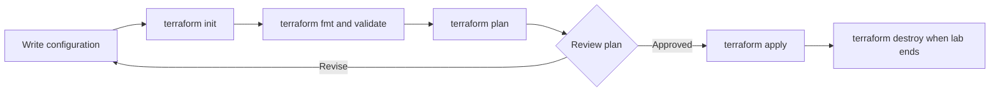

# Terraform Fundamentals — Training Repository

Hands-on course material for Infrastructure as Code, Terraform fundamentals, cloud providers, variables, outputs, state management, and collaboration.

> Audience: learners comfortable with a terminal and basic cloud concepts. Cloud examples create billable resources only if you explicitly run terraform apply. Review plans and destroy lab resources afterward.

## Learning outcomes

- Explain IaC, its benefits, and tradeoffs; compare Terraform with other tools.
- Describe Terraform architecture, providers, and the CLI workflow.
- Install Terraform on Windows, Linux, and macOS.
- Configure AWS, Azure, and Google Cloud providers without embedding credentials.
- Use variables and outputs; understand state, remote backends, and locking.
- Apply formatting, version control, review, and cleanup practices.

## Course map

| Module | Topics | Material |
|---|---|---|
| 1 | IaC, Terraform, architecture, installation, lab setup | [Module 1](modules/01-introduction/README.md) |
| 2 | Workflow, first configuration, AWS/Azure/GCP providers | [Module 2](modules/02-basics-providers/README.md) |
| 3 | Variables, outputs, state, remote state, best practices | [Module 3](modules/03-variables-state-best-practices/README.md) |

## Repository structure

```text
terraform/
├── README.md
├── .gitignore
├── diagrams/
├── modules/
│   ├── 01-introduction/
│   ├── 02-basics-providers/{aws,azure,gcp}/
│   └── 03-variables-state-best-practices/{local-state,aws-s3-backend}/
└── labs/01-local-file/
```

## Quick start: local lab, no cloud account needed

```bash
cd labs/01-local-file
terraform init
terraform fmt -check
terraform validate
terraform plan
terraform apply
terraform output
terraform destroy
```

Inspect the plan before confirming apply. PowerShell instructions are in the lab README.

## Workflow



## Provider labs

- [AWS](modules/02-basics-providers/aws/README.md): tagged S3 bucket.
- [Azure](modules/02-basics-providers/azure/README.md): resource group.
- [Google Cloud](modules/02-basics-providers/gcp/README.md): storage bucket.

Each provider README covers authentication, setup, apply, and cleanup. Use a dedicated lab account/project, least privilege, and a budget. Examples do not contain credentials.

## State and collaboration

State maps configuration to real objects and can contain sensitive values. Local state is suitable for an individual disposable exercise. Teams should use an access-controlled remote backend with encryption, versioning, and locking where supported. See [Module 3](modules/03-variables-state-best-practices/README.md) and the [S3 backend example](modules/03-variables-state-best-practices/aws-s3-backend/README.md).

## Suggested classroom sequence

1. Explain desired state, repeatability, review, drift, and tradeoffs.
2. Walk through the architecture diagram and local lab.
3. Demonstrate one cloud provider after credential setup.
4. Add variables and outputs; inspect state safely.
5. Discuss remote state, locking, secrets, Git collaboration, and teardown.
6. Ask learners to explain a plan before applying and destroy resources afterward.

## Command reference

| Command | Purpose |
|---|---|
| terraform init | Initialize directory and install providers/modules |
| terraform fmt -recursive | Format Terraform files |
| terraform validate | Check syntax and internal consistency |
| terraform plan | Preview proposed changes |
| terraform apply | Apply reviewed changes |
| terraform output | Display declared outputs |
| terraform state list | List tracked objects; state may contain secrets |
| terraform destroy | Remove managed lab resources |

Keep .terraform/, state, plan files, credentials, and real .tfvars out of Git. Commit .terraform.lock.hcl for reproducible provider selections. See [LICENSE](LICENSE).
