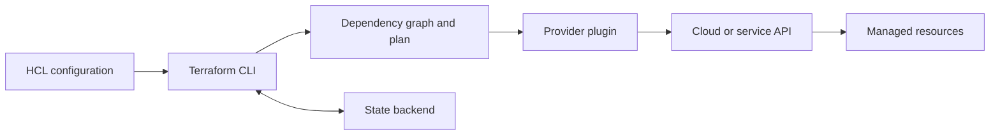

# Module 1 — Introduction to Terraform and IaC

## 1.1 Infrastructure as Code

Infrastructure as Code (IaC) describes infrastructure in machine-readable files and uses software tools to provision or configure it. Instead of manually repeating console steps, a team reviews and applies a versioned desired-state definition.

### Benefits and tradeoffs

- **Repeatability:** recreate consistent environments from the same source.
- **Reviewability:** inspect proposed changes in code review and plans.
- **Automation:** run provisioning from controlled pipelines.
- **Consistency:** reuse modules, variables, and conventions.
- **Auditability:** track who changed configuration and when.
- **Drift visibility:** compare declared intent with observed infrastructure.
- **Tradeoffs:** IaC requires state/security discipline, provider knowledge, review of destructive changes, and ongoing maintenance as APIs evolve. It does not eliminate the need for architecture or operational judgment.

### Terraform compared with selected tools

| Tool | Typical model | Common strengths | Considerations |
|---|---|---|---|
| Terraform / OpenTofu | Declarative desired state; provider ecosystem | Broad multi-provider workflows, plans, state tracking | State is critical; provider behavior and licensing/tooling choices matter |
| AWS CloudFormation | Declarative AWS stacks | Native AWS integration and service coverage | AWS-focused; stack and change-set model |
| Azure Bicep | Declarative Azure resource definitions compiled to ARM | Azure-native types and tooling | Azure-focused |
| Google Cloud Deployment Manager | Declarative Google Cloud provisioning | Google Cloud integration | Check current service lifecycle and supported alternatives before selecting |
| Ansible | Primarily procedural/configuration orchestration with declarative modules | Agentless configuration and task automation | Different execution/state model from Terraform |
| Pulumi | Infrastructure defined with general-purpose languages | Familiar programming languages and abstractions | Requires language runtime and its associated development workflow |

Choose based on provider support, team skills, lifecycle/state needs, policy requirements, and operational ecosystem. Tool capabilities and support lifecycles can change.

## 1.2 What is Terraform?

Terraform is a CLI-driven infrastructure provisioning tool. Users describe resources and relationships in HashiCorp Configuration Language (HCL). Terraform consults provider plugins to interact with APIs, compares configuration with state and remote objects, then proposes and executes changes.

### Key concepts and features

- **Providers** translate Terraform resource/data-source operations into service API calls.
- **Resources** represent managed objects; **data sources** read existing information.
- **Plan and apply** separate proposed changes from execution.
- **State** tracks resource identities and attributes.
- **Modules** package reusable configurations.
- **Dependency graph** orders operations and can parallelize independent work.
- **Variables and outputs** expose configuration inputs and useful results.
- **Lock file** records selected provider versions/checksums.

## 1.3 Architecture



- The **CLI/core** loads configuration, schema, state and backend settings.
- **Providers** are separately installed plugins selected during init.
- **Backend** stores state and may provide locking.
- **Cloud APIs** perform the actual create/read/update/delete operations.
- Terraform does not continuously reconcile infrastructure by itself; teams run plans through a chosen operational process.

See [architecture diagram source](../../diagrams/terraform-architecture.mmd).

## 1.4 Installation

Install from the official Terraform installation documentation for your OS and verify the binary with `terraform version`. Use the official package/signature guidance appropriate to your platform.

### Windows

1. Install Terraform using the official HashiCorp installation guide or a trusted package manager.
2. Ensure the Terraform executable is on `PATH`.
3. Open a new PowerShell terminal and run:
   ```powershell
   terraform version
   terraform -help
   ```

### macOS

Using Homebrew (if installed):
```bash
brew tap hashicorp/tap
brew install hashicorp/tap/terraform
terraform version
```
Alternatively use the official Terraform download/install instructions.

### Linux

Follow the official HashiCorp instructions for your distribution and package repository, including package signing-key verification. Then:
```bash
terraform version
terraform -help
```
Do not download an unverified binary from an unknown mirror.

## 1.5 Prepare a lab environment

1. Install Terraform and Git.
2. Start with [the local-file lab](../../../../labs/01-local-file/README.md), which needs no cloud credentials.
3. For cloud labs, create a dedicated sandbox account/subscription/project, set a budget, and grant the minimum permissions required.
4. Authenticate with the cloud provider CLI or supported workload identity. Never place client secrets or access keys in committed HCL.
5. Choose one provider folder in Module 2. Run init, fmt, validate, plan; inspect the plan before apply.
6. Destroy the resources and verify cleanup. Some services may leave separately billed or retained artifacts; check the provider console.

## Exercise

Explain the difference between configuration, provider, state, and a live resource. Draw the request path from HCL to cloud API. Name one benefit and one operational risk of IaC.
