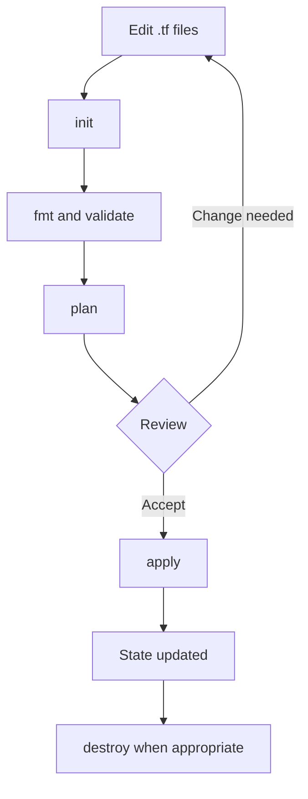

# Module 2 — Terraform Basics and Providers

## Workflow



1. **init** initializes the working directory, configures the backend, and installs provider/module dependencies.
2. **fmt** applies canonical HCL formatting.
3. **validate** checks configuration structure and types.
4. **plan** calculates and displays proposed changes; it does not apply them.
5. **apply** executes changes after confirmation (or from a saved, reviewed plan).
6. **destroy** plans and removes managed resources. Review its proposed deletions carefully.

Commands:
```bash
terraform init
terraform fmt -recursive
terraform validate
terraform plan
terraform apply
terraform destroy
```

## First configuration

A runnable example is in [the local-file lab](../../labs/01-local-file/). It demonstrates a provider-free resource and an output. The three cloud examples below are independent: use only one at a time.

## Providers

Providers are plugins that expose resources and data sources for a platform. A `required_providers` block declares source addresses and version constraints. A provider block configures non-secret settings such as region or subscription context. Authentication should normally come from the provider CLI, environment, or workload identity.

| Provider | Example source | Typical authentication |
|---|---|---|
| AWS | `hashicorp/aws` | AWS CLI profile, environment, or role |
| Azure | `hashicorp/azurerm` | Azure CLI or workload identity |
| Google Cloud | `hashicorp/google` | gcloud ADC or workload identity |

Study and run instructions: [AWS](aws/README.md), [Azure](azure/README.md), [GCP](gcp/README.md). Provider versions in examples are bounded; run init and commit the generated lock file for the chosen lab.
