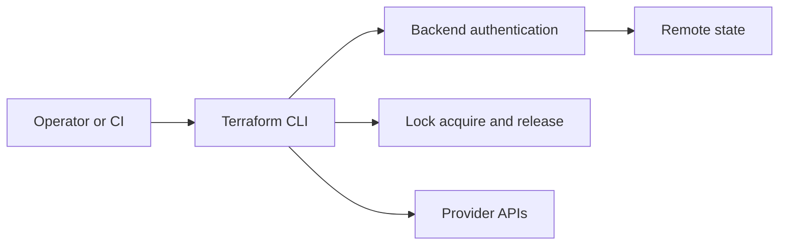

# Module 3 — Variables, Outputs, State, and Best Practices

## Variables

Input variables make a configuration reusable across environments. Declare descriptions and types; provide sensible defaults only when safe. Use validation for constraints. Supply overrides through `-var`, environment variables, or an untracked `.tfvars` file. Mark sensitive values `sensitive = true`, but remember that sensitive marking redacts display; it does not remove the value from state.

## Outputs

Outputs expose selected resource attributes for operators or calling modules. Keep outputs useful and minimal. Sensitive outputs require explicit handling and can still be present in state.

## State

Terraform state records bindings between configuration addresses and real object identities, plus attributes needed to plan future changes. It is not a backup of the infrastructure and may contain secrets.

- Restrict access like production credentials.
- Do not edit state JSON by hand.
- Do not commit state or plan files.
- Back up and version remote state according to your operational policy.
- Use `terraform state` commands deliberately; understand the effect first.

## Remote backend and locking

A remote backend stores state in shared storage and may provide locking to prevent concurrent writers. Configure it before team use; confirm the backend's access controls, encryption, versioning/recovery, and lock semantics. Never let multiple operators apply against separate local copies as if they were shared state.

See [remote state diagram](../../diagrams/remote-state.mmd) and the [AWS S3 backend example](aws-s3-backend/README.md). Backend configuration is intentionally partial because remote bucket/table creation and security policy must be completed before initialization.

## Best practices checklist

1. Use version control and small, reviewable changes.
2. Run `terraform fmt -recursive`, `terraform validate`, and inspect `terraform plan`.
3. Pin provider versions with reasonable constraints; commit `.terraform.lock.hcl`.
4. Use variables for environment-specific values and outputs for explicit interfaces.
5. Separate environments/states according to risk and lifecycle.
6. Use modules when they establish a clear reusable interface; avoid abstraction for its own sake.
7. Use least-privilege identities and short-lived credentials where possible.
8. Protect state and plan artifacts; treat logs and outputs as potentially sensitive.
9. Use remote locking for shared workflows and pipeline concurrency controls.
10. Do not apply a plan you have not reviewed. Re-plan when configuration or state changes.
11. Tag/label resources and include ownership, environment, and cost context.
12. Destroy disposable lab resources and verify the cleanup.

## Collaboration workflow

- Create a branch for a focused change.
- Format and validate locally.
- Open a pull request with purpose, impact, and plan summary.
- Keep credentials and real variable files out of commits.
- Have an authorized reviewer inspect the plan for replacements/deletions.
- Serialize applies to a given state and use locking.
- Record Terraform/provider versions and operational instructions.

## Practice

Add a validated variable and output to the local-state example. Run plan with two different values and explain why the resulting plans differ. Then inspect state with `terraform state list` and destroy the lab.
